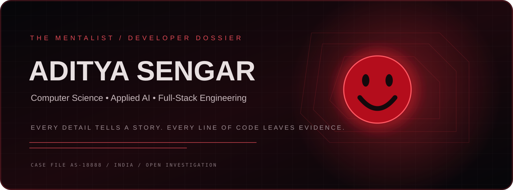
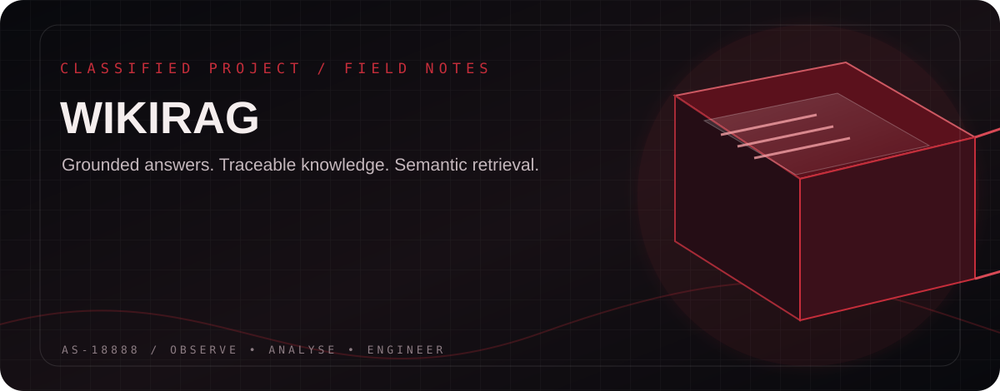
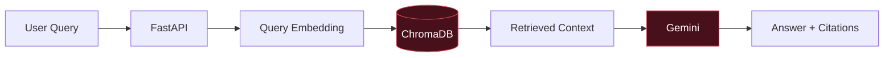
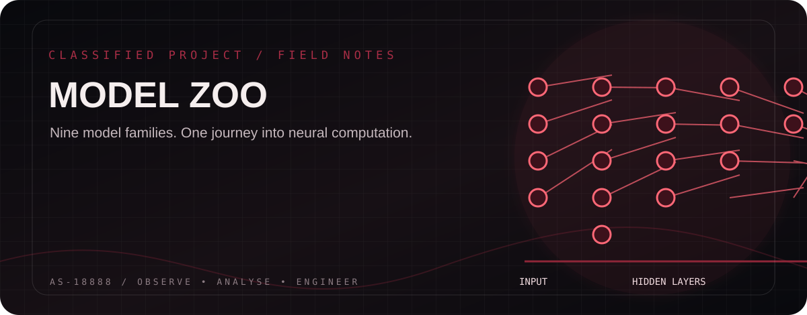
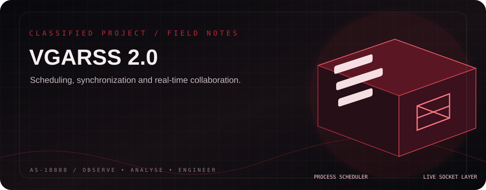
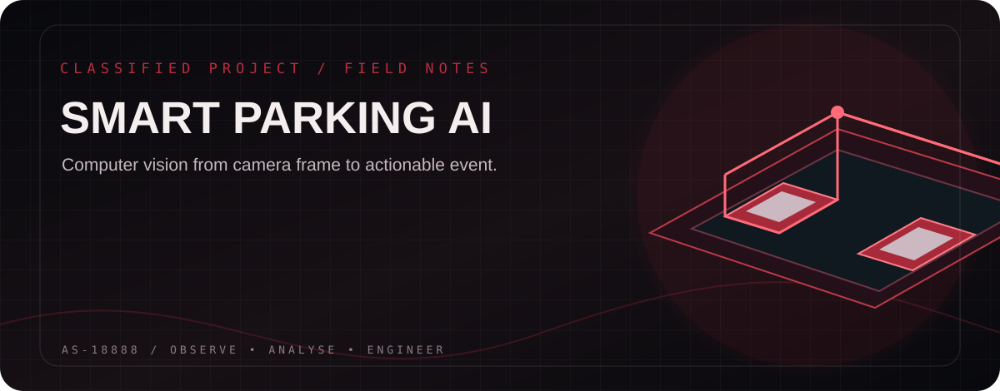
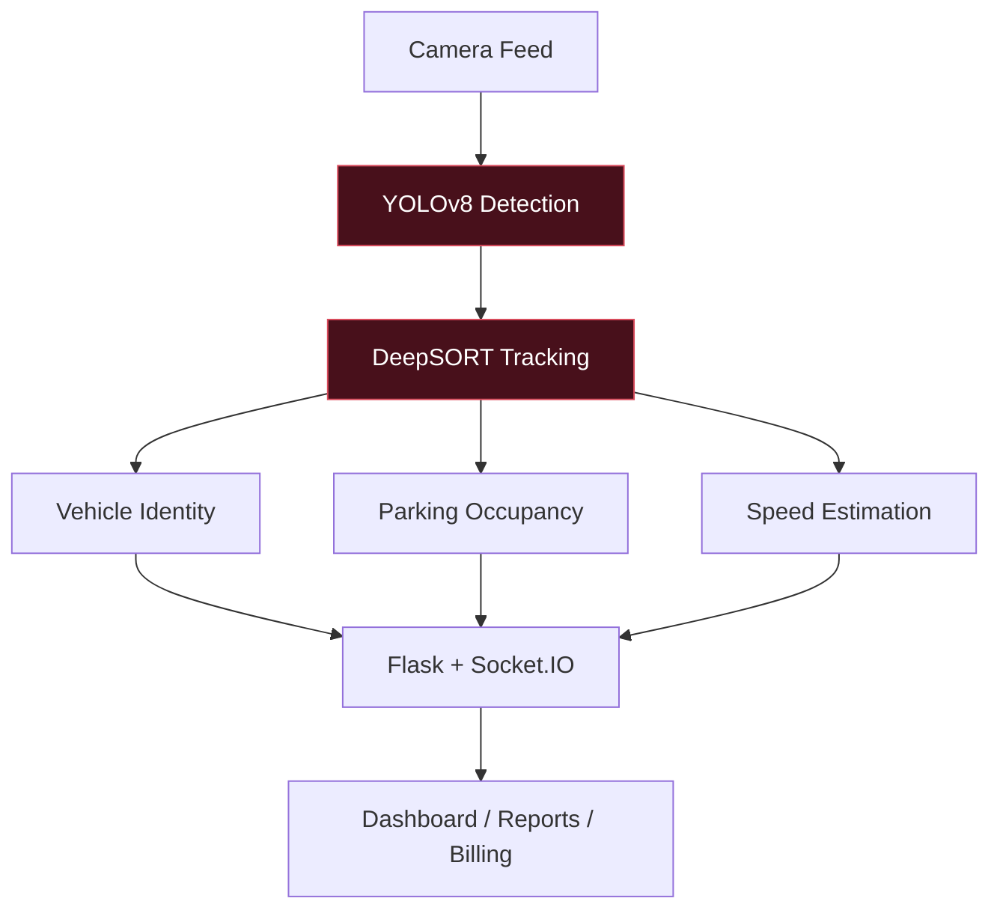
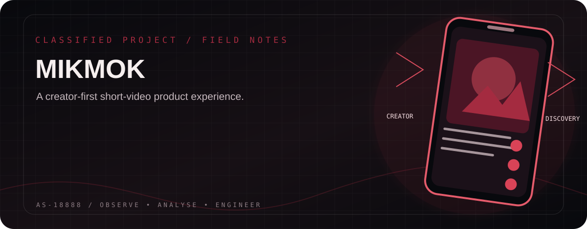
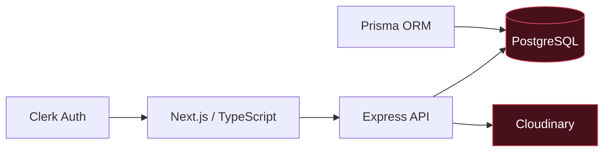
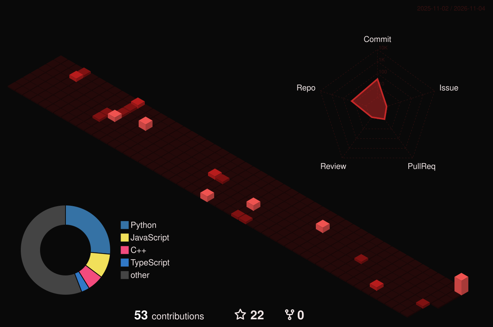

 

 

  

---

## 🔴 THE RED JOHN FILE

*“The details are always there. You just have to know where to look.”*

**SUBJECT:** Aditya Sengar  
**ROLE:** Computer Science Undergraduate · Software Developer · AI/ML Explorer  
**INSTITUTION:** Jaypee Institute of Information Technology (JIIT)

I'm a Computer Science undergraduate interested in building software that is technically sound, useful and thoughtfully engineered. My work spans **applied AI, full-stack development, machine learning, data science and systems engineering**.

I like understanding what happens behind the interface: how a retrieval pipeline finds evidence, how a neural network learns, how a scheduler allocates CPU time, and how a real-time application keeps multiple clients synchronized.

**My approach:** Observe the problem → identify the pattern → engineer the solution → verify the result.

---

## 📌 CASE DASHBOARD — BY THE NUMBERS

Repository count is based on the public profile listing. Other figures describe documented project scope or milestones; they are not third-party performance benchmarks.

---

## 🧩 THE SKILL WALL

  

<b>🔍 Technical evidence — expand the skill inventory</b>

**Programming & CS:** Python, C++, Java, JavaScript, TypeScript, data structures and algorithms, OOP, complexity analysis.

**Frontend:** React, Next.js, Vite, Tailwind CSS, responsive UI, state management.

**Backend:** Node.js, Express, FastAPI, Flask, REST APIs, WebSockets, TCP socket programming.

**AI / ML:** NumPy, Pandas, Scikit-learn, PyTorch, Hugging Face Transformers, NLP, embeddings, RAG, computer vision, YOLO, model evaluation.

**Data & infrastructure:** MySQL, PostgreSQL, SQLite, Prisma, Redis, Git, GitHub, Docker, Linux, Vercel, Netlify, Render, Cloudinary.

**3D & visualization:** Three.js, globe.gl, MapLibre GL, Recharts, Plotly.

---

# 🗃️ THE FIVE FEATURED CASES

*Five selected builds. Five different engineering investigations.*

## 01 / WikiRAG
CASE CLASSIFICATION · GENERATIVE AI / RETRIEVAL SYSTEMS

**A Wikipedia question-answering system that retrieves relevant information and produces grounded answers with citations.**

- Text chunking, embedding generation and semantic retrieval.
- ChromaDB vector storage and similarity search.
- Gemini-powered response generation.
- FastAPI backend with streaming answers.
- Source citations for traceable responses.

**Pipeline**

STACK Python · FastAPI · Gemini · ChromaDB · Embeddings · RAG

🔗 [Explore WikiRAG](https://github.com/Adityasengar18888/WikiRAG)

---

## 02 / Model Zoo
CASE CLASSIFICATION · DEEP LEARNING / NEURAL COMPUTATION

**A neural-network experimentation platform focused on understanding model architectures and the mechanics of learning.**

9 MODEL FAMILIES DOCUMENTED

- NumPy-based automatic differentiation and tensor operations.
- Forward propagation and backpropagation.
- Model training, evaluation and optimization.
- Experiments spanning MNIST, CIFAR-10, IMDB, AG News, Cora and Tiny Shakespeare.
- FastAPI-powered model exploration interface.

STACK Python · NumPy · FastAPI · Neural Networks · CNN · RNN · LSTM · Transformers · GAN · GCN

🔗 [Explore Model Zoo](https://github.com/Adityasengar18888/Model-Zoo)

---

## 03 / VGARSS 2.0
CASE CLASSIFICATION · OPERATING SYSTEMS / NETWORKING / COLLABORATION

**Virtual Group Asynchronous Real-Time Resource Synchronization & Scheduling System.**

A multi-user collaboration platform combining task coordination, real-time communication and interactive operating-system simulations.

**Operating systems laboratory**
- FCFS, SJF, SRTF, Round Robin and Priority scheduling with aging.
- Five-state process lifecycle visualization.
- Mutex and semaphore synchronization.
- Deadlock detection using wait-for graph cycle detection.
- Gantt charts and scheduling metrics.

**Networking laboratory**
- Authenticated WebSocket communication.
- Real-time presence and message synchronization.
- Offline message catch-up, heartbeat and latency monitoring.
- Concurrent TCP server with paired-client message forwarding.
- Four-byte big-endian length-prefixed message framing.
- Configured payload protection up to **1 MB**.

STACK Python · FastAPI · React · TypeScript · WebSockets · TCP · SQLite · PostgreSQL

🔗 [Explore VGARSS](https://github.com/Adityasengar18888/VGARSS) · 🌐 [Live Demo](https://vgarss.vercel.app)

---

## 04 / Smart Parking & Traffic Monitoring
CASE CLASSIFICATION · COMPUTER VISION / REAL-TIME AUTOMATION

**A computer-vision system for vehicle detection, parking occupancy, number-plate recognition and traffic monitoring.**

- YOLOv8 vehicle detection.
- DeepSORT tracking with persistent object IDs.
- EasyOCR number-plate recognition.
- OpenCV parking-space occupancy detection.
- Line-based speed estimation and violation logging.
- Duration-based parking billing and PDF receipts.
- Live dashboard and CSV reporting.

STACK Python · OpenCV · YOLOv8 · DeepSORT · EasyOCR · Flask · Socket.IO · ReportLab

🔗 [Explore Smart Parking](https://github.com/Adityasengar18888/Smart-Parking-and-Traffic-Monitoring-System)

---

## 05 / MIKMOK
CASE CLASSIFICATION · FULL-STACK / SOCIAL PRODUCT ENGINEERING

**A short-form video social platform built around creator interactions, media uploads and content discovery.**

- Vertical short-video feed.
- Clerk authentication and user authorization.
- Cloudinary video upload and media storage.
- Likes, comments, shares and creator follows.
- Search across users, videos and hashtags.
- Notifications and PostgreSQL-backed application data.
- Responsive Next.js interface.

**Application architecture**

STACK Next.js · React · TypeScript · Tailwind CSS · Clerk · Express · Prisma · PostgreSQL · Cloudinary · Zustand · React Query

🌐 [Live Project](https://mikmok-nu.vercel.app) · 🔗 [Source Code](https://github.com/Adityasengar18888/MIKMOK)

---

## 🧪 BEYOND THE FIVE — RESEARCH & EXPERIMENTS

The featured projects are the primary portfolio. Other technical explorations include:

- **ResonanceStorm:** Three.js, WebXR, multiplayer synchronization and a custom Verlet-based physics simulation.
- **ApxForge:** Black–Scholes option pricing, Greeks, payoff visualization and quantitative analytics.
- **Glassdoor Review Summarizer:** DistilBART summarization, DistilBERT sentiment analysis and FastAPI.
- **TerraScope:** 3D globe, MapLibre GL, geographic exploration and itinerary planning.
- **Business Entity Resolution:** Record linkage, normalization, candidate generation and matching.

[Browse all public repositories →](https://github.com/Adityasengar18888?tab=repositories)

---

# 🎓 EDUCATION & CREDENTIALS

**Jaypee Institute of Information Technology (JIIT)**  
B.Tech — Computer Science and Engineering · 2024–Present

**Professional training**
- AppDrive Technologies Pvt. Ltd. — Industrial training, 6 weeks (June–July 2026).
- Labmentix — AI/ML internship experience.

### Certification vault

**Google**
- Google Advanced Data Analytics Professional Certificate.
- The Nuts and Bolts of Machine Learning.
- Foundations of Data Science.
- Go Beyond the Numbers: Translate Data into Insights.
- Regression Analysis: Simplify Complex Data Relationships.
- The Power of Statistics.

**IBM**
- Machine Learning with Python.

**DeepLearning.AI**
- Applied Statistics for Data Analytics.
- Data Analytics Foundations.

**HackerRank**
- Frontend Developer (React).

**Hackathons & participation**
- Chronomind — Certificate of Participation.
- BLACKBOX.AI — Offline Round.
- Innovate 3.0 — Final Round.
- HackwithIndia — Vibe Hack 2.0.

---

# ⚔️ THE TRAINING ROOM — PROBLEM SOLVING

**Areas of practice:** Arrays · Hashing · Linked Lists · Trees · Graphs · Dynamic Programming · Greedy · Binary Search · Sliding Window · Complexity Analysis.

---

# 📈 THE EVIDENCE WALL — LIVE GITHUB DATA

  

  

## 🧊 3D CONTRIBUTION CHAMBER

 

The 3D contribution graphic is generated by the profile repository's scheduled GitHub Actions workflow. Run the workflow once from the Actions tab to generate the first image.

---

# 🕵️ CURRENT INVESTIGATION

---

# 📡 ESTABLISH CONTACT

  

**OBSERVE. THINK. BUILD. REPEAT.**

CASE FILE AS-18888 · THE MENTALIST EDITION · LAST UPDATED NOVEMBER 2026

